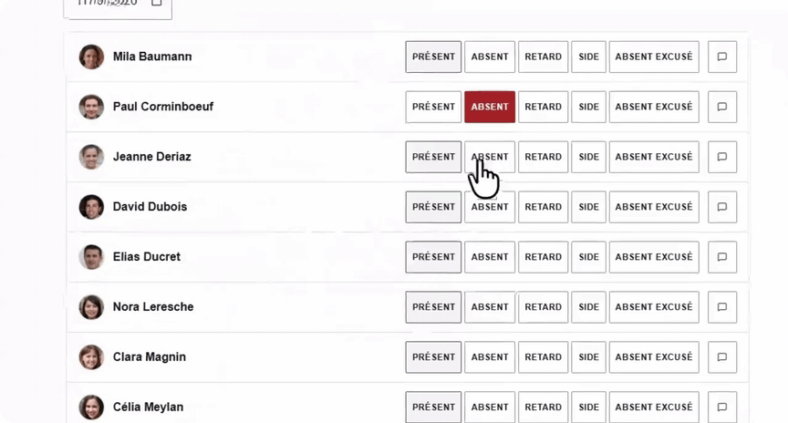
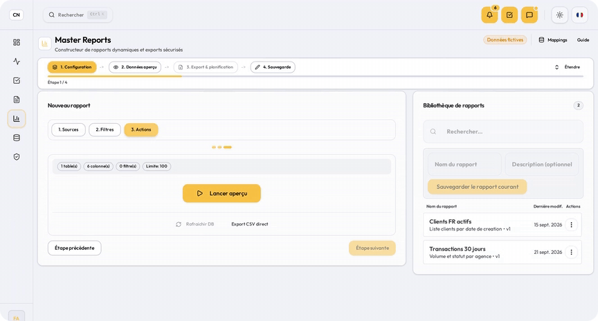
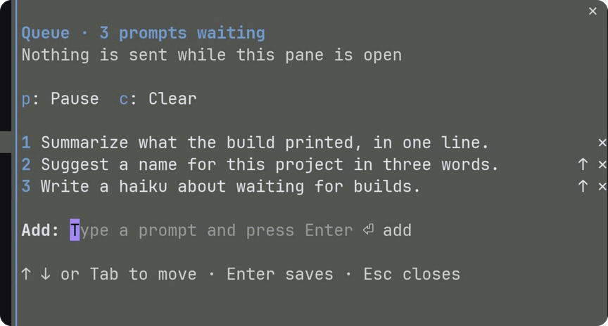

<picture><source media="(prefers-color-scheme: dark)" srcset="assets/entete-sombre.svg"></picture>

J'aide les PME romandes à sortir d'Excel avec des applications web sur mesure.

  

<table>
<tr>
<td width="50%" valign="top">

<a href="https://florian-anthony.ch/fr/thalie"><picture><source media="(prefers-color-scheme: dark)" srcset="assets/carte-thalie-sombre.gif"></picture></a>

**[Thalie](https://florian-anthony.ch/fr/thalie)** Présences et évaluations sur téléphone, diplôme ES.

</td>
<td width="50%" valign="top">

<a href="https://florian-anthony.ch/fr/capital-nexus"><picture><source media="(prefers-color-scheme: dark)" srcset="assets/carte-nexus-sombre.gif"></picture></a>

**[Capital Nexus](https://florian-anthony.ch/fr/capital-nexus)** Rapports et exports de données, réalisé en stage.

</td>
</tr>
<tr>
<td width="50%" valign="top">

<a href="https://github.com/florian-anthony/claude-code-mods"><picture><source media="(prefers-color-scheme: dark)" srcset="assets/carte-pq-sombre.gif"></picture></a>

**[prompt-queue](https://github.com/florian-anthony/claude-code-mods)** Une file de messages pour Claude Code, open source.

</td>
<td width="50%" valign="top">

<a href="https://planfixe.ch"><picture><source media="(prefers-color-scheme: dark)" srcset="assets/carte-planfixe-sombre.gif"></picture></a>

**[Plan Fixe](https://planfixe.ch)** Site et galerie d'un photographe, en sept langues.

</td>
</tr>
</table>

<b>Un processus qui tourne encore sur Excel&nbsp;?</b> <a href="https://florian-anthony.ch/fr/projet">Parlons-en</a>

          

   
